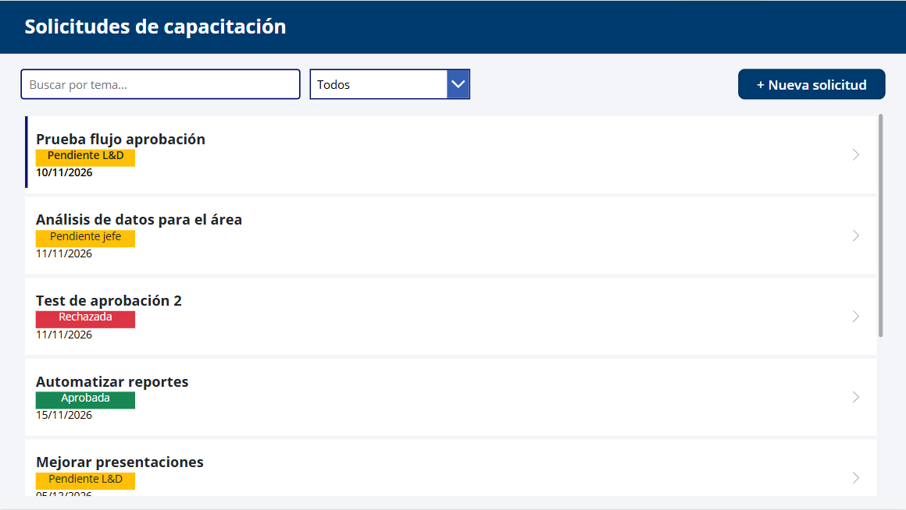
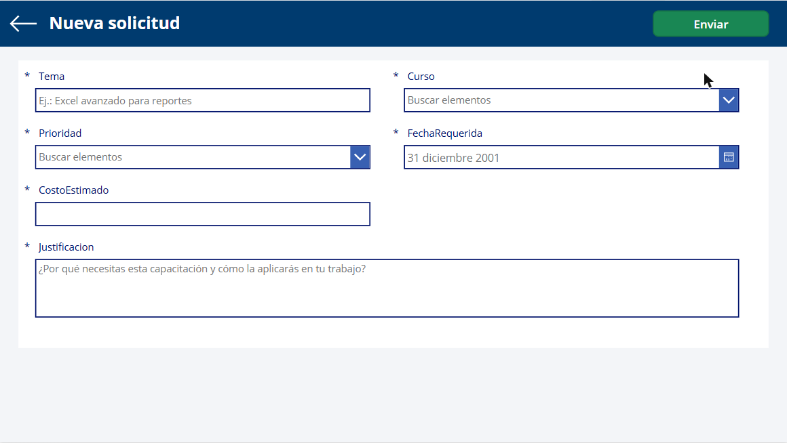
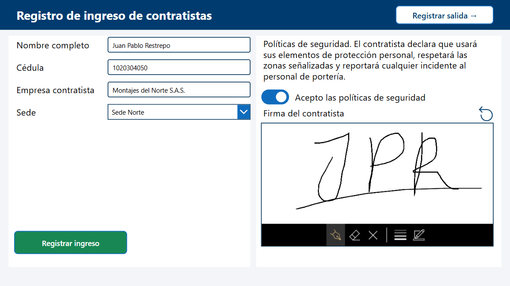
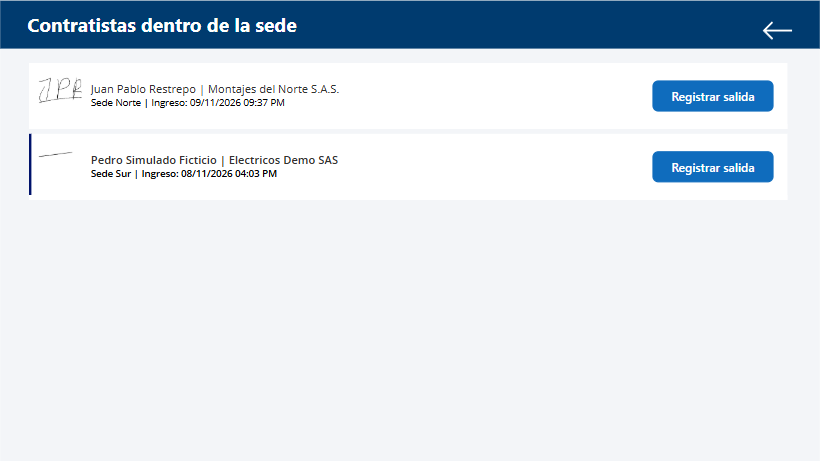
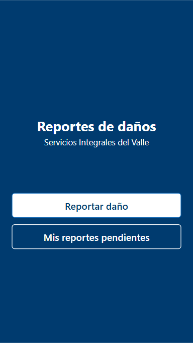
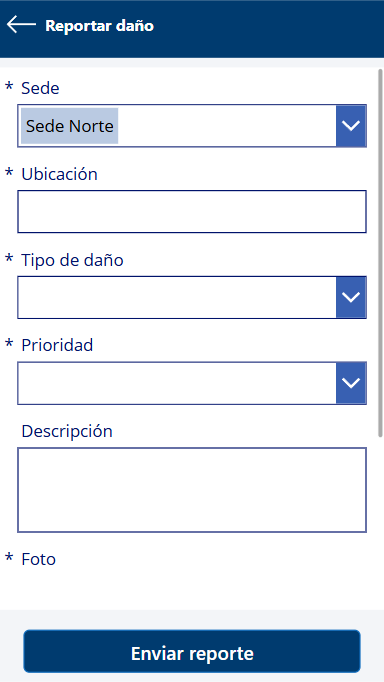
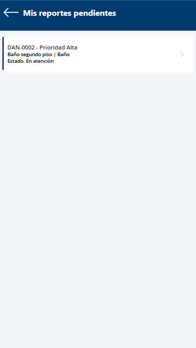
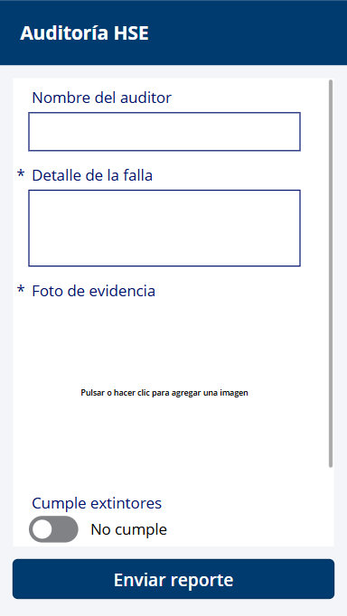
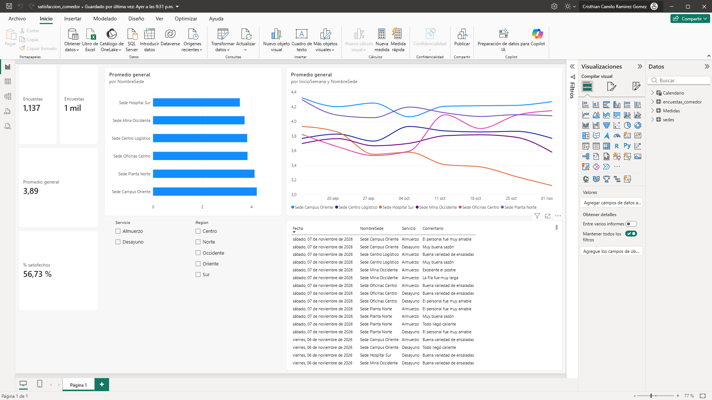

# Portafolio de innovación con Power Platform

Prototipos de soluciones para operaciones de servicios de alimentación y facilities, construidos en un laboratorio personal con **datos ficticios**. Cada uno responde a una restricción o problema que podría estar ocurriendo en el día a día de la operación, como punto de partida para validarlo con las áreas.

## Cómo trabajo

1. **Problema primero:** entiendo qué pasa hoy (papel, WhatsApp, Excel) y qué cuesta.
2. **Prototipo ágil, producción con método:** construyo una versión mínima con datos ficticios, la valido con los usuarios del área en ciclos cortos y, cuando demuestra valor, la llevo a producción con levantamiento, seguridad, piloto y capacitación.
3. **Construido con apoyo de IA:** el problema, el diseño, la experiencia de usuario y las reglas de calidad los defino yo, y verifico cada resultado en el dato.
4. **Gobernanza desde el inicio:** soluciones con editor y prefijo propios, despliegue administrado, roles de seguridad, cuentas de servicio y cuidado de los datos personales.
5. **Medir:** cada propuesta trae sus indicadores para saber si funcionó.

## Prototipos

| # | Propuesta | Problema que resuelve | Herramientas | Estado |
|---|---|---|---|---|
| 1 | [Reporte de daños en sedes](fichas/01_reporte_danos_sedes.md) | Daños reportados por WhatsApp, técnicos que se enteran tarde | Power Apps, Dataverse, Power Automate, Teams | Prototipo funcional, listo para piloto |
| 2 | [Auditoría HSE móvil](fichas/02_auditoria_hse.md) | Listas de chequeo en papel, hallazgos sin evidencia | Power Apps (lienzo y basada en modelo), Dataverse | Prototipo funcional, listo para piloto |
| 3 | [Control de acceso de contratistas](fichas/03_control_acceso_contratistas.md) | No se sabe quién está dentro de cada sede | Power Apps, Dataverse, Power Automate, Teams | Prototipo funcional, listo para piloto |
| 4 | [Tablero de satisfacción del comedor](fichas/04_tablero_satisfaccion_comedor.md) | Sedes que empeoran sin que nadie lo note | Power BI | Prototipo funcional, listo para piloto |
| 5 | [Solicitudes de capacitación](fichas/05_solicitudes_capacitacion.md) | Solicitudes perdidas en correos, sin estado claro | Power Apps, SharePoint, Power Automate, Teams | Prototipo funcional, listo para piloto |

## Lo que tienen en común

- **Experiencia de usuario consistente:** sistema de colores definido una sola vez, etiquetas de estado de color y botones pensados para el celular o la tableta.
- **Calidad verificada:** comprobador de soluciones sin problemas críticos ni altos, y pruebas de punta a punta revisando el dato final, no solo el mensaje de éxito.
- **Listos para crecer:** cada ficha incluye licencias, riesgos, supuestos y la siguiente fase.

## Capturas

**Solicitudes de capacitación**

**Control de acceso de contratistas**

**Reporte de daños (celular)**

  

**Auditoría HSE (celular)**

**Tablero de satisfacción del comedor (Power BI)**

Más detalle en la carpeta [capturas](capturas/).

## Contacto

[Nombre] · [Correo] · [LinkedIn]
